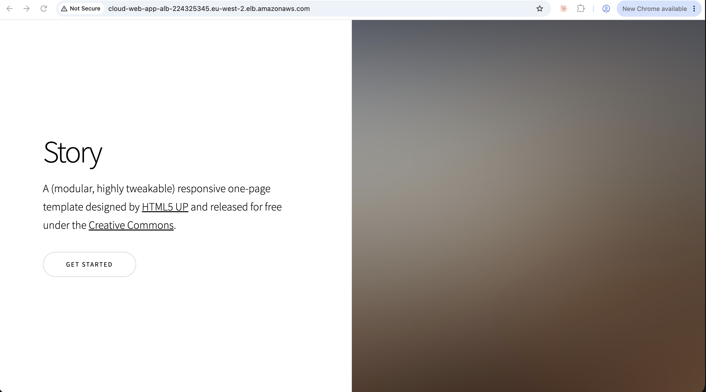
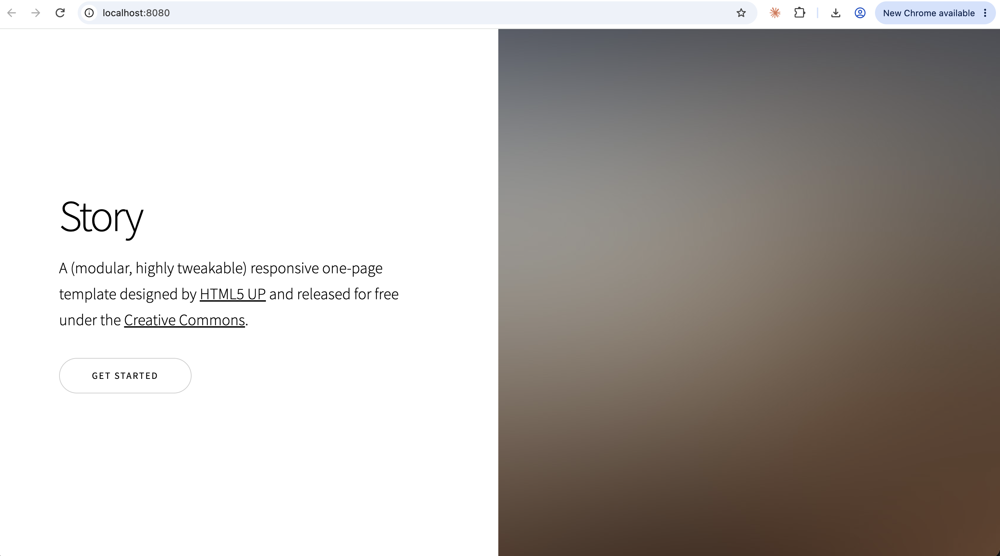

# Cloud Web App on AWS

## Overview

A static website running in a Docker container with Nginx, deployed to AWS ECS Fargate behind an Application Load Balancer. All the AWS infrastructure is built with Terraform, and the next step is adding a GitHub Actions pipeline for deployments.

The website is a free template. The work in this project is the Docker, AWS, Terraform and pipeline side.

## Features

- Website runs inside a Docker container using Nginx
- Container runs as a normal user instead of root
- Image is built for linux/amd64 so it can run on AWS Fargate
- Two copies of the container run across two Availability Zones
- Application Load Balancer with health checks only sends traffic to healthy containers
- Containers only accept traffic from the load balancer
- ECS rolls back automatically if a new version keeps failing
- Terraform state is stored in an encrypted S3 bucket with locking
- Docker images are stored in a private ECR repository and scanned on push

## Technologies

- Docker
- Nginx
- Terraform
- AWS (VPC, ECS Fargate, ECR, Application Load Balancer, IAM, CloudWatch, S3)
- Git and GitHub
- GitHub Actions

## Project Structure

```
cloud-web-app/
  app/
    site/          website files
    Dockerfile
  terraform/
    bootstrap/     S3 state bucket and GitHub OIDC role
    modules/
      network/     VPC and subnets
    main.tf        ECR, load balancer and ECS
  .github/
    workflows/     pipelines
  docs/            screenshots
```

## How to Run Locally

Docker needs to be installed.

```bash
cd app
docker build --platform linux/amd64 -t cloud-web-app:local .
docker run -d -p 8080:8080 --name cloud-web-app cloud-web-app:local
```

Then open http://localhost:8080

To stop it:

```bash
docker stop cloud-web-app && docker rm cloud-web-app
```

## How to Deploy to AWS

1. Create the state bucket and GitHub role (only needed once):

```bash
cd terraform/bootstrap
terraform init
terraform apply
```

2. Create the ECR repository and push the image:

```bash
cd ..
terraform init
terraform apply -target=aws_ecr_repository.app -var="image_tag=v1"
ECR_URL=$(terraform output -raw ecr_repository_url)
aws ecr get-login-password --region eu-west-2 | docker login --username AWS --password-stdin ${ECR_URL%/*}
docker build --platform linux/amd64 -t $ECR_URL:v1 ../app
docker push $ECR_URL:v1
```

3. Build everything else:

```bash
terraform apply -var="image_tag=v1"
```

The website address is shown in the `website_url` output.

To remove everything:

```bash
terraform destroy -var="image_tag=v1"
```

## Screenshots

Running on AWS:



Running locally:



## Progress

- [x] Website running in Docker
- [x] Terraform state bucket in S3
- [x] AWS infrastructure built with Terraform
- [x] Website deployed to ECS Fargate
- [ ] GitHub Actions pipeline

## Issues I Ran Into

The AWS CLI gave a SignatureDoesNotMatch error. The region had been saved as "Eu-north-1" and the output as "Json" with capital letters. AWS settings are case sensitive, so I set them again with `aws configure set region eu-west-2` and `aws configure set output json`.

My Mac has an Apple chip, but Fargate runs on x86. I build the image with `--platform linux/amd64` so it works on AWS. Docker shows a warning when running it on the Mac, but it still works.

ECS needs an image in ECR before it can start any containers. I created the ECR repository on its own first with `-target`, pushed the image, and then built the rest.

After deploying, the ECS console showed no clusters. The console was set to N. Virginia but everything was in London (eu-west-2). AWS regions are separate, so you have to be in the right one to see your resources.

## Credits

Website template: Story by HTML5 UP (html5up.net), under the Creative Commons Attribution 3.0 licence.